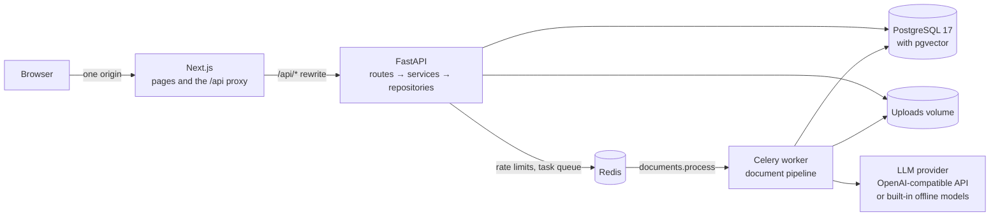
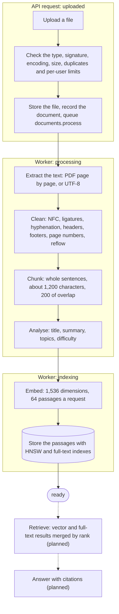
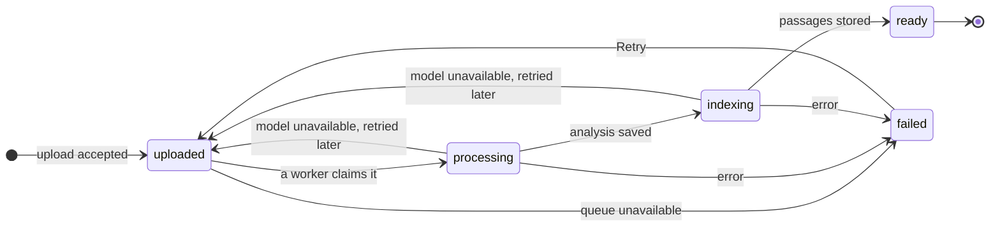
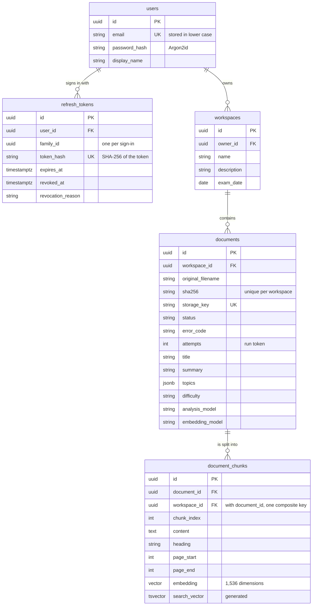

# Recall — AI Study Platform

[](https://github.com/APELSINKos/ai-study-platform/actions/workflows/ci.yml)

## Overview

Recall is a self-hosted web application for preparing for exams from your own material. You create a workspace for each course or exam and upload lecture notes or textbook chapters as PDF, Markdown or plain-text files. A background worker reads every file, cleans its text, splits it into passages, analyses it (title, summary, topics, difficulty and estimated study time) and stores a vector embedding for each passage in PostgreSQL with pgvector. Those passages are what the next features build on: answers with citations, quizzes and flashcards with spaced repetition. The whole stack starts with one Docker Compose command and needs no API key: built-in offline models stand in until an OpenAI-compatible endpoint is configured.

| Area | Status |
| --- | --- |
| Accounts and sessions: registration, sign-in, session refresh, sign-out | Working |
| Workspaces, one per course or exam, with an exam-date countdown | Working |
| Document upload and background processing: extraction, cleaning, chunking, analysis, embeddings | Working |
| Web interface in English and Russian, with light and dark themes | Working |
| Retrieval: hybrid vector and full-text search over the passages | Planned |
| Chat with citations to the source passages | Planned |
| Quizzes generated from the material | Planned |
| Flashcards with spaced repetition | Planned |
| Progress dashboard (today the dashboard lists the recent workspaces) | Planned |
| Evaluation of retrieval and answers (`make evaluate`) | Planned |

## Features

**Accounts.** Registration and sign-in with e-mail and password (Argon2id hashes). Sessions live in httpOnly cookies with CSRF protection and are refreshed silently, rotating the refresh token each time. API clients use bearer tokens. Registration and sign-in are rate-limited.

**Workspaces.** A name, a description and an optional exam date with a countdown ("Exam in 12 days"). The list is ordered by the latest change and shows how many documents each workspace has, and how many of them are still processing or have failed. Deleting a workspace deletes its documents, their passages and their files.

**Documents.**

- PDF, Markdown (`.md`) and plain-text (`.txt`) files of up to 20 MiB, uploaded by drag and drop or the file picker. The browser checks each file against the limits from `GET /api/v1/meta` before sending it; the API checks again: the extension, the `%PDF-` signature, strict UTF-8 for text files (no UTF-16 or UTF-32 byte-order mark, no NUL bytes), the size, and a SHA-256 duplicate check within the workspace.
- Per-user limits: 10 documents in processing at once, 1 GiB of stored files, 60 uploads and 30 retries an hour.
- Processing limits: 500 PDF pages, 2,000,000 characters of text and 5,000 passages per document, capped PDF decompression and a 9-minute deadline per run.
- Every file shows where its processing stands on a status rail: uploaded, processing, indexing, ready, or failed with the reason in the interface language. The list asks for news every 2 seconds while a file is on its way and stops once all of them are ready or failed.
- Retry for a failed document, and for one that has not changed status for 15 minutes ("This is taking longer than usual").
- A document page with the title, summary, topics, difficulty, estimated study time, page, word and passage counts, processing time and the model that analysed the file; the passages ("fragments") with their heading path and page range; download of the original file; deletion.

**Interface.** English and Russian, switched in the header and remembered in a cookie (the browser's language decides on the first visit); light, dark and system themes; layouts for phones and desktops; animations that respect reduced motion; a landing page and a system status page that checks the database and the task queue.

**Operations.** Structured logs, JSON or console, with a request ID that follows an upload into the worker; Prometheus metrics for HTTP requests at `/metrics`; liveness and readiness probes; health checks on every long-running Compose service.

## Architecture



- The browser talks only to Next.js. It renders the pages and rewrites `/api/*` to FastAPI, so the session cookies are first-party and CORS plays no part in normal use.
- An upload is stored on a volume shared with the worker, recorded as `uploaded` and queued in Redis; the API answers `202 Accepted` at once.
- The Celery worker processes the document and records each stage in PostgreSQL; the browser polls for it.
- The worker reaches models only through provider interfaces: an OpenAI-compatible API, or the built-in offline models when no key is set.

The backend is layered so that HTTP, rules and SQL stay apart:

```
route        app/api/v1/        HTTP only: parameters, status codes, authentication
  ↓
service      app/services/      rules, ownership checks, transactions (services commit)
  ↓
repository   app/repositories/  SQLAlchemy queries (repositories only flush)
  ↓
PostgreSQL   app/models/, migrations in alembic/versions/
```

Document processing lives in `app/documents/` (upload checks, storage, extraction, cleaning, chunking and the pipeline), model access in `app/llm/` (provider protocols, the OpenAI-compatible and offline implementations, prompts), and the Celery app and its task in `app/workers/`. Abstractions exist where they pay for themselves: the model providers have two implementations and a protocol between them, while file storage is a single class that tests simply give a temporary root folder.

```
backend/     FastAPI application, Celery worker, Alembic migrations, tests
frontend/    Next.js application, unit and end-to-end tests
compose.yaml Local stack: PostgreSQL, Redis, migrations, API, worker, web client
Makefile     Shortcuts for the commands below
```

## Tech Stack

| Layer | Technology | Used for |
| --- | --- | --- |
| Web client | Next.js 16, React 19, TypeScript | Pages and the `/api` proxy |
| | Tailwind CSS 4, shadcn/ui-style components on Radix primitives, Motion | Styling, accessible dialogs and controls, animation |
| | TanStack Query 5 | Server state: caching, polling, pagination |
| | React Hook Form, Zod | Forms and their validation |
| | next-intl, next-themes | English and Russian, light and dark themes |
| API | Python 3.13, FastAPI, Pydantic 2 | REST API, validation, OpenAPI schema |
| | SQLAlchemy 2, psycopg 3, Alembic | Data access and migrations |
| | argon2-cffi, PyJWT | Password hashing, access tokens |
| Processing | Celery 5, Redis 8 | Background jobs; Redis also holds the rate-limit counters |
| | pypdf | Text extraction from PDF files |
| | openai SDK | Any OpenAI-compatible API |
| Data | PostgreSQL 17, pgvector 0.8 | Relational data, vectors and full-text search in one database |
| Observability | structlog, prometheus-client | Structured logs with request IDs, metrics |
| Quality | pytest, ruff, mypy; Vitest, Testing Library, Playwright; ESLint, Prettier | Tests, linting, type checks |
| Delivery | Docker Compose, multi-stage Dockerfiles, GitHub Actions | Local stack, development and production images, CI |

## RAG Pipeline

Answering from your material needs the material prepared first. Ingestion works today; retrieval and answering come next.



1. **Upload.** The API checks the file and stores it as `{workspace_id}/{document_id}{extension}`; the name the user chose is kept for display and never becomes part of a path.
2. **Extract.** PDF files are read page by page, so every passage knows its pages; Markdown and text files are decoded as UTF-8.
3. **Clean.** The text is normalised to NFC; ligatures, non-breaking and zero-width characters, soft hyphens, words hyphenated across lines or pages, running headers and footers, and page-number lines are dealt with one by one. Lines that the PDF layout wrapped are joined into paragraphs, while headings, list items and code keep their own lines.
4. **Chunk.** Whole sentences are packed into passages of about 1,200 characters, each starting with up to 200 characters of the previous passage's last sentences, so text at a boundary keeps its context. Markdown is split by sections first and every passage keeps its heading path; PDF passages keep their page range.
5. **Analyse.** The model sees the file name and at most 12,000 characters: a short file whole, a longer one as an outline of its headings, its beginning and three windows further on. It returns a title, a summary, topics and a difficulty. The estimated study time is computed rather than guessed: 200 words a minute, times 1.0, 1.3 or 1.6 by difficulty.
6. **Embed and store.** Passages are embedded in batches into 1,536-dimensional vectors, then stored in the same transaction that marks the document `ready`.

The statuses form a small state machine:



An unavailable model is retried twice, after 30 and 60 seconds (or as long as the provider asks, up to 5 minutes); meanwhile the interface shows "Retrying soon". A model that refuses a document for good is replaced by the built-in analysis and the document still becomes ready; a retry reuses an analysis saved by an earlier attempt with the same model, so nothing is paid for twice. Embedding errors fail the document. A failed document carries one code from a closed set: file problems (`pdf_unreadable`, `pdf_encrypted`, `no_text`, `too_many_pages`, `text_too_long`, `file_missing`), model problems (`ai_unavailable`, `ai_quota_exceeded`, `ai_rejected`, `ai_invalid_output`, `embedding_dimension_mismatch`) and run problems (`processing_timeout`, `queue_unavailable`, `internal_error`). Retry puts a failed document back to `uploaded`, as it does a document stuck in an earlier status for 15 minutes.

Next, a question will be embedded the same way; the passages nearest to it by cosine distance will be merged with full-text matches by Reciprocal Rank Fusion, and the model will answer only from those passages, citing them, or say that the material does not cover the question.

## Database Schema



| Table | Key constraints |
| --- | --- |
| `users` | Unique e-mail, stored in lower case |
| `refresh_tokens` | Unique token hash; indexes on the user and the session family; revocation reason limited to `rotated`, `signed_out`, `reuse_detected` |
| `workspaces` | Owner foreign key with cascading delete; index on (owner, last change) for the list |
| `documents` | Unique (workspace, SHA-256), so a repeated upload is a 409; checks on the status, content type, difficulty, size, SHA-256 format, topics (a JSON array) and counts; the error code must come from the closed set and a failed document must have one; a ready document must have its passage count, embedding model and finish time |
| `document_chunks` | Composite foreign key (document, workspace) → documents with cascading delete, so a passage cannot sit in another workspace than its document; unique (document, chunk index); HNSW index on the embedding for cosine distance (m = 16, ef_construction = 64); a generated `tsvector` over heading and content (the `simple` configuration) with a GIN index; checks on the chunk index, length and page range |

Primary keys are UUIDs and times are `timestamptz`. Enumerated columns are strings guarded by named CHECK constraints. The schema is created only by Alembic migrations, which the `migrate` service applies on start; application code never creates tables. Planned tables: chat sessions and messages, generation jobs, quizzes with questions, attempts and answers, flashcards with their rating history, and study sessions.

## Local Development

Requires Docker with Compose v2 for the stack, and Node 22, the version in `.nvmrc` (`npm ci` in `frontend/`), for the frontend checks and `make e2e` (once: `npx playwright install chromium`).

```bash
docker compose up --build
```

Compose starts PostgreSQL and Redis, applies the migrations with a one-off `migrate` service, then starts the API, the worker and the web client, each with a health check. Every port is bound to 127.0.0.1. The API reloads on code changes, the worker restarts on them, and the web client runs `next dev`. The defaults work without any configuration and without an API key.

| Service | URL |
| --- | --- |
| Web client | http://localhost:3000 |
| System status page | http://localhost:3000/status |
| API documentation | http://localhost:8000/docs |
| Metrics (Prometheus format) | http://localhost:8000/metrics |

| Command | What it does |
| --- | --- |
| `make up` / `make down` | Start or stop the stack |
| `make test` | Backend tests (with PostgreSQL and Redis) and frontend tests |
| `make lint`, `make typecheck` | ruff, mypy, ESLint, Prettier, TypeScript |
| `make e2e` | Playwright tests against the running stack |
| `make migrate` | Apply database migrations |
| `make api-types` | Regenerate the frontend API types from the backend OpenAPI schema |

## Environment Variables

Every variable is optional: Compose reads it from the environment or a `.env` file and falls back to the default below. `.env.example` lists them all.

| Variable | Default | Meaning |
| --- | --- | --- |
| `ENVIRONMENT` | `development` | `development`, `test` or `production`. Production refuses the development `SECRET_KEY` and marks cookies Secure |
| `LOG_LEVEL` | `INFO` | `DEBUG`, `INFO`, `WARNING` or `ERROR` |
| `LOG_FORMAT` | `console` | `console` to read, `json` for log collectors |
| `POSTGRES_USER`, `POSTGRES_PASSWORD`, `POSTGRES_DB` | `study` | Database user, password and name |
| `POSTGRES_PORT`, `REDIS_PORT`, `BACKEND_PORT`, `FRONTEND_PORT` | `5433`, `6380`, `8000`, `3000` | Host ports |
| `CORS_ORIGINS` | `http://localhost:3000` | Comma-separated origins that may call the API directly |
| `METRICS_TOKEN` | blank | When set, `/metrics` requires `Authorization: Bearer <token>`; in production `/metrics` is hidden without one |
| `SECRET_KEY` | blank (a development key) | Signs access tokens; production requires at least 32 characters |
| `COOKIE_SECURE` | blank | Blank means Secure cookies in production only |
| `LLM_PROVIDER` | `auto` | `auto`, `mock` or `openai`; `auto` uses the API once `OPENAI_API_KEY` is set |
| `OPENAI_API_KEY` | blank | Key for the analysis model, and for embeddings unless they have an endpoint of their own |
| `LLM_BASE_URL` | `https://api.openai.com/v1` | Any OpenAI-compatible API, such as OpenRouter or a local Ollama server |
| `LLM_MODEL` | `gpt-5.4-mini` | The model that analyses documents |
| `EMBEDDING_PROVIDER` | `auto` | As `LLM_PROVIDER`, for embeddings: `auto` uses the API once embeddings have a key (see below) |
| `EMBEDDING_API_KEY` | blank | Key for an embeddings endpoint of its own |
| `EMBEDDING_BASE_URL` | blank | That endpoint; needs `EMBEDDING_API_KEY` |
| `EMBEDDING_MODEL` | `text-embedding-3-small` | Must return 1,536-dimensional vectors |

With no key set, the built-in models do the work: `mock-heuristic-v1` analyses documents and `mock-hashing-v1` embeds passages. Setting `OPENAI_API_KEY` switches both to the API at `LLM_BASE_URL`. Keys and URLs are paired, so a key only ever reaches the endpoint it was configured for: with `EMBEDDING_API_KEY` and `EMBEDDING_BASE_URL` both blank, embeddings use the `OPENAI_API_KEY` and `LLM_BASE_URL` pair; otherwise they use `EMBEDDING_API_KEY` with `EMBEDDING_BASE_URL` (OpenAI when blank) and never fall back to `OPENAI_API_KEY`. The API and the worker refuse to start with `EMBEDDING_BASE_URL` but no `EMBEDDING_API_KEY`, or with a provider forced to `openai` without a key; local servers accept any placeholder key. `GET /api/v1/meta` reports the models in use and the mode, `offline` while either of them is built in and `live` otherwise, never keys or addresses.

A local server such as Ollama works the same way. Set `OPENAI_API_KEY` to any placeholder, since `auto` needs a key even where the server checks none, and `LLM_BASE_URL` to `http://host.docker.internal:11434/v1`, the host as the containers see it on every platform. Embeddings then go to that server as well and ask it for `text-embedding-3-small` unless `EMBEDDING_MODEL` names another model: set `EMBEDDING_PROVIDER=mock` to keep the built-in embeddings, or name a model there that returns 1,536-dimensional vectors.

Limits such as the upload size are settings with fixed defaults in `backend/app/core/config.py`, not Compose variables; the upload limit is tied to `frontend/next.config.ts` (see Design Decisions).

## Running Tests

| Command | What runs |
| --- | --- |
| `make test` | Backend tests in the container, with PostgreSQL and Redis, then the frontend unit and component tests |
| `make lint` | ruff, ruff format, ESLint, Prettier |
| `make typecheck` | mypy in strict mode, TypeScript |
| `make e2e` | Playwright against the running stack at http://localhost:3000 |

- **Backend (pytest).** Unit tests for the text processing, the providers and the settings; API tests through the whole application; integration tests on real PostgreSQL and Redis. The fixtures create a separate `study_test` database, migrate it with Alembic and use Redis database 15, so development data is never touched. Every warning is an error.
- **No network, no paid model.** Tests use the offline providers or fakes, and the Celery task runs in-process without a broker.
- **Hostile input.** Text processing runs on untrusted files, so its regular expressions are written to stay linear, and timing tests feed it 2,000,000-character runs of the characters that would make a careless pattern backtrack.
- **Frontend (Vitest, Testing Library).** Component and hook tests in jsdom, including keyboard use, polling and both languages.
- **End to end (Playwright).** The landing and status pages, the account lifecycle, and a document's whole way: upload, processing to ready, the document page with its summary and passages, a duplicate turned down, a 12 MiB file that fails as too long, a file over 20 MiB turned down in the browser without a request, and the workspace's deletion. The two suites that need an account register one each, since registration is rate-limited, and the document suite first checks `GET /api/v1/meta` and stops unless the offline models are in use.
- **CI (GitHub Actions)** on every push to `main` and every pull request: the backend job installs the dependencies locked in `uv.lock`, failing when the lock no longer matches `pyproject.toml`, and runs ruff, mypy and pytest with coverage against PostgreSQL with pgvector and Redis service containers; the frontend job runs ESLint, Prettier, TypeScript, Vitest and a production build on the Node version in `.nvmrc`; a contract job regenerates the TypeScript API types from the backend's OpenAPI schema and fails on any difference.

## Evaluation

Planned. `make evaluate` will run a small set of questions with expected answers and source documents through retrieval and answering, and measure retrieval precision and recall, answer correctness and latency, with the results saved as files in the repository.

## API Documentation

FastAPI serves interactive documentation at http://localhost:8000/docs (Swagger UI) and http://localhost:8000/redoc (ReDoc), and the OpenAPI schema at http://localhost:8000/openapi.json. The API's routes are under `/api/v1`, and the web client reaches them through Next.js at http://localhost:3000/api/v1; metrics are served apart, at `/metrics`. The frontend's TypeScript types are generated from this schema (`make api-types`), and CI fails when they drift.

| Area | Endpoints |
| --- | --- |
| Auth | `POST /auth/register`, `POST /auth/login`, `POST /auth/token`, `POST /auth/refresh`, `POST /auth/logout`, `GET /auth/me` |
| Workspaces | `GET`, `POST /workspaces`; `GET`, `PATCH`, `DELETE /workspaces/{id}` |
| Documents | `POST`, `GET /workspaces/{id}/documents`; `GET`, `DELETE /documents/{id}`; `GET /documents/{id}/chunks`; `GET /documents/{id}/file`; `POST /documents/{id}/retry` |
| Meta | `GET /meta`: upload limits, accepted file types, per-user limits, the models in use (public) |
| Health | `GET /health/live`, `GET /health/ready` |

Lists take `?page=1&page_size=20` (at most 100) and return `{"items": [...], "total": ..., "page": ..., "page_size": ...}`. Every error has the same shape:

```json
{
  "error": {
    "code": "duplicate_document",
    "message": "This file has already been uploaded to the workspace.",
    "details": [],
    "request_id": "5f0c1b9e2a7d4c3e8b6a1d2f3e4c5b6a"
  }
}
```

| Status | Codes |
| --- | --- |
| 401 | `not_authenticated`, `token_expired`, `invalid_token` |
| 403 | `csrf_failed` |
| 404 | `workspace_not_found`, `document_not_found`, `document_file_missing` |
| 409 | `duplicate_document`, `document_not_retryable`, `storage_quota_exceeded` |
| 413 | `payload_too_large` |
| 415 | `unsupported_file_type` |
| 422 | `validation_error`, `invalid_text_encoding`, `empty_file` |
| 429 | `rate_limited`, `too_many_active_documents`, with `Retry-After` |
| 500 | `internal_error`, without internals; the `request_id` finds it in the logs |

### Authentication

The web client signs in with httpOnly cookies and a double-submit CSRF token. API clients, including Swagger's "Authorize" button, use a bearer token from `POST /api/v1/auth/token` instead. Access tokens are short-lived JWTs; refresh tokens are opaque, stored hashed, and rotated on every use — a token used again after rotation revokes its whole session family. Sign-in and registration are both rate-limited; the per-IP limits assume a reverse proxy in front that overwrites `X-Forwarded-For` with the real client address. In the bundled compose stack, browser requests arrive through the web client and share one address, so the per-e-mail login limit is what actually stops password guessing there.

## Screenshots

Screenshots will be added once the study features have their finished interface.

## Design Decisions

**Synchronous FastAPI routes.** Routes are plain functions on SQLAlchemy's synchronous API with psycopg 3, and FastAPI runs them in its thread pool. The Celery worker is synchronous as well, so the API and the worker share one set of models, repositories and services instead of an async copy for one and a sync copy for the other. The slow work, parsing files and calling models, happens in the worker rather than in requests. The price is that the thread pool bounds how many requests are handled at once.

**Celery and Redis for processing.** Parsing a PDF and calling models can take minutes, so an upload only stores the file, records the document, queues a task and answers `202 Accepted`. Celery brings what this needs: a task is acknowledged only once it finishes, so a task whose worker died is delivered again; soft and hard time limits; retries with backoff. Redis was already in the stack for rate limits, so it doubles as the broker rather than adding another service. Publishing has bounded connect, socket and retry timeouts, so an upload to a dead broker ends in under 30 seconds, before the web proxy gives up, as a failed document (`queue_unavailable`) that Retry can queue again.

**pgvector inside PostgreSQL.** Passages, their vectors and their full-text index live in the database that already holds the documents. One transaction stores a document's passages and marks it ready, deleting a document deletes its vectors through a cascade, and there is no second store to run or keep in sync. The embedding is a column of `document_chunks`, one vector per passage, rather than a table of its own. Each passage also keeps its `workspace_id`, because search will always filter by workspace; the composite foreign key keeps that copy equal to the document's.

**Provider interfaces with offline models.** The pipeline depends on two small protocols, `LLMProvider` and `EmbeddingProvider`, not on a vendor's SDK. One implementation talks to any OpenAI-compatible API through the official SDK, with an explicit key, URL, timeouts and retries; the other is built in: a heuristic analysis and hashed word embeddings that are deterministic and need no network. So the stack runs and every test passes without an API key, and no test depends on a model or pays for one. A model's answer is requested as JSON matching a Pydantic schema and validated again on arrival, with one chance to repair it. Keys are resolved together with their URLs because chat and embeddings often come from different vendors: a key must never be sent to a host it was not issued for (the pairing rule under Environment Variables).

**A run token, retries and the stale Retry.** A run claims its document with one compare-and-set update, from `uploaded` to `processing` with `attempts` increased by one, and keeps the new `attempts` as its token; every later write checks it. A duplicate or redelivered message for a claimed document therefore finds nothing to claim, and a run whose document was deleted or claimed again writes nothing more. Database work happens in short transactions, never while a file is parsed or a model answers, and locks the document row before its passages: the order in which a delete takes them through its cascade, so the two cannot deadlock. A model that is only unavailable leaves the document `uploaded` for a later attempt; other errors fail it with their code, except an analysis the model refuses, which the built-in one replaces. A run that died with its worker leaves a document stuck in an earlier status; once its status has not changed for 15 minutes, longer than any run may take, Retry is offered for it.

**NFC, not NFKC.** Stored text is normalised to NFC. NFKC would fold characters that carry meaning in study material: x² would become x2, H₂O would become H2O and ½ would become 1⁄2. Cleaning instead deals one by one with the characters that cause trouble, such as ligatures, non-breaking and zero-width spaces and soft hyphens. Only the offline embedder applies NFKC and case folding, to its own tokens, for matching.

**20 MiB uploads through the Next.js proxy.** The browser talks only to Next.js, which rewrites `/api/*` to FastAPI so that session cookies stay first-party. Next.js cuts proxied request bodies at `experimental.proxyClientMaxBodySize`, 10 MiB by default, so `next.config.ts` raises it to `21mb` (21 MiB): the 20 MiB file limit plus room for the multipart envelope. Next.js keeps a proxied body in memory, so every upload in flight can hold up to that much there. The API has limits of its own: an upload's body is capped at 20 MiB plus 64 KiB and any other request body at 1 MiB; an upload is authenticated before its body is read, and the file's real size is checked again. Sizes use binary units throughout; the interface writes 20 MiB as "20 MB".

**Cookie sessions with CSRF and refresh-token rotation.** The web client never handles a token: the API sets an access JWT (15 minutes, sent only to `/api`) and an opaque refresh token (14 days, sent only to `/api/v1/auth`, stored as a SHA-256 hash) as httpOnly cookies, out of reach of any script injected into the page. Because the browser sends cookies by itself, every unsafe request authenticated by cookie must also repeat the `recall_csrf` cookie's value in an `X-CSRF-Token` header. Each refresh rotates the refresh token; a rotated token presented again revokes the whole session family, except within 10 seconds of its rotation, which covers two tabs refreshing at once.

**One error contract.** Every error, from validation and rate limits to an unexpected crash, has the same body with a stable snake_case `code` for one condition and a `request_id` to find it in the logs. The English `message` is for developers: the web client maps codes to its own English and Russian sentences. Another user's workspace or document is answered with 404, never 403, so ids cannot be probed, and ownership is checked before anything is written. A failed document's `error_code` comes from a closed set that a CHECK constraint enforces and the generated TypeScript types carry, so a code without a translation fails the frontend's type check.

**Documents are untrusted input.** A file name never becomes part of a path. PDF decompression is capped at 8 MiB per stream, 2 MiB of content per page and 32 MiB per document, and the worker container may use at most 2 GiB of memory. Every regular expression applied to document text stays linear on hostile input. Document text reaches a model only inside one delimited block of the user message, under a fixed system prompt that calls it data, with look-alike delimiters in the text replaced.

## Limitations

- The offline analysis is heuristic: the title comes from the front matter, the first heading or a first line that stands alone; the summary from the first sentences; the topics from the headings the text returns to and its repeated phrases, then from word frequencies; and the difficulty from a readability score. The offline embeddings match shared words, not meaning. Real models need an API key.
- There is no OCR: a scanned PDF without a text layer fails with `no_text`.
- The interface is in English and Russian only.
- It is a single-node setup: one Compose stack, with uploaded files on a local volume shared by the API and the worker, and no object storage or replicas. The per-IP rate limits assume a reverse proxy that sets `X-Forwarded-For` (see Authentication).
- The vector size is fixed at 1,536 dimensions, and documents processed before a change of embedding model keep their old vectors; there is no command to re-embed them yet.
- Processing status is polled every 2 seconds rather than pushed, and an upload shows no percentage.
- Synchronous routes: FastAPI's thread pool bounds how many requests run at once.

## Future Improvements

- Retrieval and search: vector and full-text results merged by Reciprocal Rank Fusion, then chat that answers only from the retrieved passages, cites them and says when the material does not cover a question.
- Quizzes generated as schema-validated JSON, with results, history and mistakes turned into flashcards.
- Flashcards with spaced repetition (Again, Hard, Good, Easy) and export to Anki.
- A dashboard with study time, accuracy, weak topics, upcoming repetitions and recommendations.
- Evaluation with `make evaluate`.
- Hardening and delivery: production images built in CI, dependency and secret scanning, end-to-end tests in CI, re-embedding after a model change, OCR for scanned PDFs.

## License

[MIT](LICENSE)
