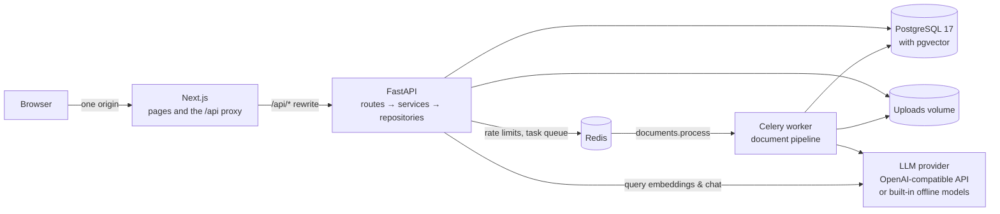
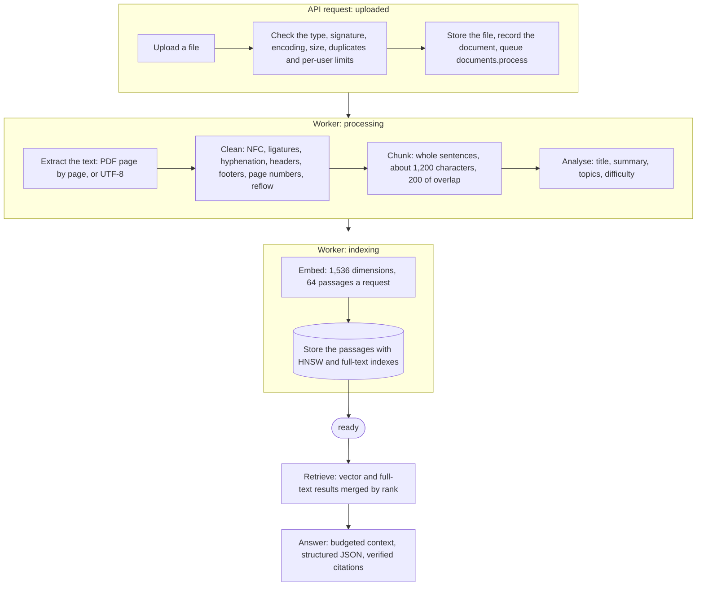
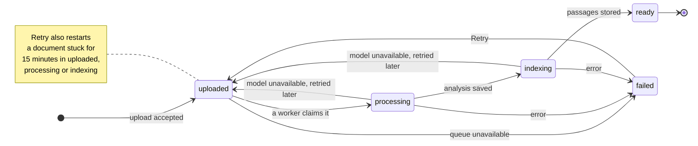
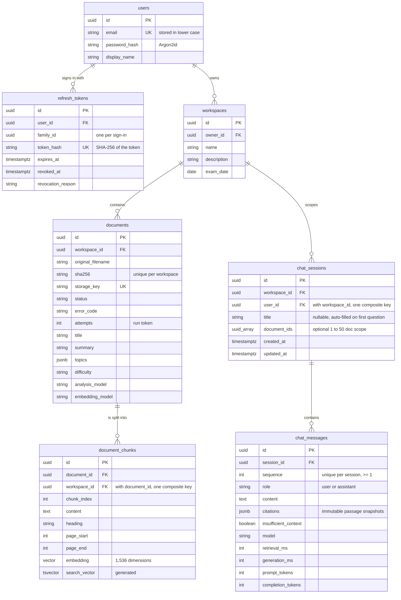

# Recall — AI Study Platform

[](https://github.com/APELSINKos/ai-study-platform/actions/workflows/ci.yml)

## Overview

Recall is a self-hosted web application for preparing for exams from your own material. You create a workspace for each course or exam and upload lecture notes or textbook chapters as PDF, Markdown or plain-text files. A background worker reads every file, cleans its text, splits it into passages, analyses it (title, summary, topics, difficulty and estimated study time) and stores a vector embedding for each passage in PostgreSQL with pgvector. Search finds a workspace's passages by their words and embeddings together, and chat answers questions strictly from those passages with inline citations that preview and open the source passage—or says honestly when the material does not cover the question. The next features build on the same passages: quizzes and flashcards with spaced repetition. The whole stack starts with one Docker Compose command and needs no API key: built-in offline models stand in until an OpenAI-compatible endpoint is configured.

| Area | Status |
| --- | --- |
| Accounts and sessions: registration, sign-in, session refresh, sign-out | Working |
| Workspaces, one per course or exam, with an exam-date countdown | Working |
| Document upload and background processing: extraction, cleaning, chunking, analysis, embeddings | Working |
| Search: hybrid vector and full-text search over a workspace's passages, each result opening its document at the passage | Working |
| Chat: workspace- or document-scoped grounded Q&A with numbered inline citations, source previews and passage deep links | Working |
| Web interface in English and Russian, with light and dark themes | Working |
| Quizzes generated from the material | Planned |
| Flashcards with spaced repetition | Planned |
| Progress dashboard (today the dashboard lists the recent workspaces) | Planned |
| Evaluation of retrieval and answers (`make evaluate`) | Planned |

## Features

**Accounts.** Registration and sign-in with e-mail and password (Argon2id hashes). Sessions live in httpOnly cookies with CSRF protection and are refreshed silently, rotating the refresh token each time. API clients use bearer tokens. Registration and sign-in are rate-limited.

**Workspaces.** A name, a description and an optional exam date with a countdown ("Exam in 12 days"). The list is ordered by the latest change and shows how many documents each workspace has, and how many of them are still processing or have failed. Deleting a workspace deletes its documents, their passages and their files.

**Documents.**

- PDF, Markdown (`.md`) and plain-text (`.txt`) files of up to 20 MiB, uploaded by drag and drop or the file picker. The browser checks each file against the limits from `GET /api/v1/meta` before sending it; the API checks again: the extension, the `%PDF-` signature, strict UTF-8 for text files (no UTF-16 or UTF-32 byte-order mark, no NUL bytes), the size, and a SHA-256 duplicate check within the workspace.
- Per-user limits: 10 documents in processing at once, 1 GiB of stored files, 60 uploads and 30 retries an hour. A user's uploads and retries take turns at the check of the first two, so requests sent in parallel cannot get past them together.
- Processing limits: 500 PDF pages, 2,000,000 characters of text and 5,000 passages per document, capped PDF decompression, 768 MiB of memory for each worker process, and a 9-minute deadline per run, which holds even while the PDF library opens or repairs a file.
- Every file shows where its processing stands on a status rail: uploaded, processing, indexing, ready, or failed with the reason in the interface language. The list and the document page ask for news every 2 seconds while a file is on its way, every 15 seconds once every file on its way has stalled, and stop once all of them are ready or failed, or when the API turns the request down.
- Retry for a failed document, and for one that has not changed status for 15 minutes ("This is taking longer than usual").
- A document page with the title, summary, topics, difficulty, estimated study time, page, word and passage counts, processing time and the model that analysed the file; the passages with their heading path and page range; download of the original file; deletion.

**Search.** Each workspace page has a search box. A search looks through the passages of the workspace's ready documents by their words and their embeddings at once and lists the best ten, each with its document, heading path and pages, a snippet with the matching words marked, and how it was found: "Matching words", and "Similar meaning", or "Similar words" while the built-in embeddings, which compare words, are in use. A result opens its document scrolled to that passage, with the focus on it. The query stays in the address, so Back and Forward step through earlier searches. Notes say when files are still being processed, when some were embedded by another model and wait for a re-index, and when only the words were searched. A query holds at most 200 characters, a user may search 30 times a minute, and the API never writes a query to its logs or metrics.

**Chat.** Signed-in users can start chat sessions scoped to a workspace or narrowed to up to 50 specific documents (from the Chat navigation tab or "Ask in chat" on a workspace with ready files). Each turn retrieves relevant passages, generates a grounded answer with numbered inline citations (`[1]`, `[2]`) and a Sources list, and stores immutable passage snapshots on the assistant message. Clicking any citation opens a preview popover with the document title, heading path, page range, quoted excerpt and an "Open passage" link to that exact passage in its document. When retrieval finds no relevant passages, the chat model is skipped and Recall shows a localized insufficient-context callout instead of guessing; the same callout appears if retrieved passages do not cover the question or an answer fails citation verification. Built-in offline answering (`mock-heuristic-v1`) works without API keys. Sessions can be renamed, re-scoped, switched through a slide-over drawer and deleted; each holds up to 200 messages (2,000 characters each), users may send 20 messages a minute, and question, answer or passage text is never written to logs or metrics.

**Interface.** English and Russian, switched in the header and remembered in a cookie (the browser's language decides on the first visit); light, dark and system themes; layouts for phones and desktops; animations that respect reduced motion; a landing page that shows what uploading, searching and cited chat do today and marks the features still to come—quizzes and flashcards—as coming next; and a system status page that checks the database and the task queue.

**Operations.** Structured logs, JSON or console, with a request ID that follows an upload into the worker; Prometheus metrics at `/metrics` for HTTP requests, passage retrieval duration (`retrieval_duration_seconds`), AI call durations (`llm_request_duration_seconds` for `query_embedding` and `chat`) and reported model token counts (`llm_tokens_total`); liveness and readiness probes; health checks on every long-running Compose service.

## Architecture



- The browser talks only to Next.js. It renders the pages and rewrites `/api/*` to FastAPI, so the session cookies are first-party and CORS plays no part in normal use.
- An upload is stored on a volume shared with the worker, recorded as `uploaded` and queued in Redis; the API answers `202 Accepted` at once.
- The Celery worker processes the document and records each stage in PostgreSQL; the browser polls for it.
- The worker, and the API for search queries and chat turns, reach models only through provider interfaces: an OpenAI-compatible API, or the built-in offline models when no key is set.

The backend is layered so that HTTP, rules and SQL stay apart:

```
route        app/api/v1/        HTTP only: parameters, status codes, authentication
  ↓
service      app/services/      rules, ownership checks, transactions (services commit)
  ↓
repository   app/repositories/  SQLAlchemy queries (repositories only flush)
  ↓
PostgreSQL   app/models/, migrations in alembic/versions/
```

Document processing lives in `app/documents/` (upload checks, storage, extraction, cleaning, chunking and the pipeline), model access in `app/llm/` (provider protocols, the OpenAI-compatible and offline implementations, structured output and prompts), retrieval and grounded answering in `app/rag/` (`vector_store.py`, `retriever.py`, `snippets.py`, `query.py`, `context.py`, `citations.py` and the HTTP-free `service.py`), chat session lifecycle and endpoints in `app/services/chat.py`, `app/repositories/chat.py` and `app/api/v1/chat.py`, the Celery app and its task in `app/workers/`, and the chat interface in `frontend/src/features/chat/`. Abstractions exist where they pay for themselves: the model providers have two implementations and a protocol between them, while file storage is a single class that tests simply give a temporary root folder.

```
backend/     FastAPI application, Celery worker, Alembic migrations, tests
frontend/    Next.js application, unit and end-to-end tests
compose.yaml Local stack: PostgreSQL, Redis, migrations, API, worker, web client
Makefile     Shortcuts for the commands below
```

## Tech Stack

| Layer | Technology | Used for |
| --- | --- | --- |
| Web client | Next.js 16, React 19, TypeScript | Pages and the `/api` proxy |
| | Tailwind CSS 4, shadcn/ui-style components on Radix primitives, Motion | Styling, accessible dialogs and controls, animation |
| | TanStack Query 5 | Server state: caching, polling, pagination |
| | React Hook Form, Zod | Forms and their validation |
| | next-intl, next-themes | English and Russian, light and dark themes |
| API | Python 3.13, FastAPI, Pydantic 2 | REST API, validation, OpenAPI schema |
| | SQLAlchemy 2, psycopg 3, Alembic | Data access and migrations |
| | argon2-cffi, PyJWT | Password hashing, access tokens |
| Processing | Celery 5, Redis 8 | Background jobs; Redis also holds the rate-limit counters |
| | pypdf | Text extraction from PDF files |
| | openai SDK | Any OpenAI-compatible API |
| Data | PostgreSQL 17, pgvector 0.8 | Relational data, vectors and full-text search in one database |
| Observability | structlog, prometheus-client | Structured logs with request IDs, metrics |
| Quality | pytest, ruff, mypy; Vitest, Testing Library, Playwright; ESLint, Prettier | Tests, linting, type checks |
| Delivery | Docker Compose, multi-stage Dockerfiles, GitHub Actions | Local stack, development and production images, CI |

## RAG Pipeline

Answering from your material needs the material prepared first, the right passages found and every claim checked against them. Ingestion, retrieval and grounded answering with citations all work today.



1. **Upload.** The API checks the file and stores it as `{workspace_id}/{document_id}{extension}`; the name the user chose is kept for display and never becomes part of a path.
2. **Extract.** PDF files are read page by page, so every passage knows its pages; Markdown and text files are decoded as UTF-8.
3. **Clean.** The text is normalised to NFC; ligatures, non-breaking and zero-width characters, soft hyphens, words hyphenated across lines or pages, running headers and footers, and page-number lines are dealt with one by one. Lines that the PDF layout wrapped are joined into paragraphs, while headings, list items and code keep their own lines.
4. **Chunk.** Whole sentences are packed into passages of about 1,200 characters, each starting with up to 200 characters of the previous passage's last sentences, so text at a boundary keeps its context. Markdown is split by sections first and every passage keeps its heading path; PDF passages keep their page range.
5. **Analyse.** The model sees the file name and at most 12,000 characters: a short file whole, a longer one as its beginning and three windows further on, after an outline of its headings when it is Markdown. It returns a title, a summary, topics and a difficulty. The estimated study time is computed rather than guessed: 200 words a minute, times 1.0, 1.3 or 1.6 by difficulty.
6. **Embed and store.** Passages are embedded in batches into 1,536-dimensional vectors, then stored in the same transaction that marks the document `ready`.

The statuses form a small state machine:



A model that is unavailable (a timeout, no connection, HTTP 408 or 409, a 429 rate limit, or a server error other than 501) is retried twice, after 30 and 60 seconds (longer if the provider asks, but at most 5 minutes); meanwhile the interface shows "Retrying soon", and a model still unavailable after that fails the document with `ai_unavailable`. Every other error is final, among them a spent quota (HTTP 402, or a 429 about the quota) and HTTP 501, which a compatible server answers to a request it does not support at all. An analysis the model refuses for good is replaced by the built-in one and the document still becomes ready; a final embedding error fails the document. A retry reuses an analysis that the same model saved in an earlier attempt instead of asking for it again, but not one the built-in analysis stood in for. A failed document carries one code from a closed set: file problems (`pdf_unreadable`, `pdf_encrypted`, `no_text`, `too_many_pages`, `text_too_long`, `file_missing`), model problems (`ai_unavailable`, `ai_quota_exceeded`, `ai_rejected`, `ai_invalid_output`, `embedding_dimension_mismatch`) and run problems (`processing_timeout`, `queue_unavailable`, `internal_error`). Retry puts a failed document back to `uploaded`, as it does a document stuck in an earlier status for 15 minutes.

Retrieval (`GET /api/v1/search`) works on the ready documents of one workspace:

1. **Normalise.** The query is cleaned like document text: NFC, with invisible and control characters removed. It may hold at most 200 characters.
2. **Embed.** The query is embedded by the same model as the passages, with a 10-second limit and no retries, well within the web proxy's 30 seconds. A query that excludes words (`-word`) is not embedded, since an embedding cannot leave words out: it is matched by its words alone.
3. **Two lists.** The vector list takes the 40 passages nearest to the query by cosine distance, only from documents embedded by the current model, and drops those with a similarity below 0.05. The keyword list takes the 40 best matches of `websearch_to_tsquery('simple', …)`, which understands quotes for phrases, `or` and `-`, ranked by `ts_rank_cd`; it covers every ready document.
4. **Merge.** Reciprocal Rank Fusion gives each passage 1 / (60 + rank) from every list it appears in. Ties go to the better rank in a single list, then to the passage id, so the same query always returns the same order.
5. **Snippets.** `ts_headline` picks up to two short excerpts around the matching words, and the API returns them as plain and highlighted parts, with an ellipsis wherever text is left out. A passage found by its embedding alone shows its first 30 words.

When the query cannot be embedded, a hybrid search returns the keyword list and reports `semantic_available: false`.

Grounded chat (`POST /api/v1/chat/sessions/{id}/messages`) builds directly on the same retriever:

1. **Query building (`app/rag/query.py`).** Extracts up to 14 folded alphanumeric content words from the question (skipping English and Russian chat stop words and augmenting short follow-ups with the most recent prior user turn) and joins them with `or` within 256 characters for full-text search, without `-word` exclusions. The embedding query appends the prior user turn on short follow-ups up to 1,000 characters.
2. **Scoped retrieval and empty short-circuit (`app/rag/service.py`).** Runs hybrid search for the top 5 passages (`CHAT_TOP_K = 5`) inside the session's workspace and optional `document_ids`, degrading to keyword-only if query embedding fails (5-second limit, no retries). If no ready documents or no passages match, the chat model is skipped completely and the turn records `insufficient_context: true` with `model: null`.
3. **Context budget and prompt-injection boundaries (`app/rag/context.py`, `app/llm/prompts.py`).** Packs passages under server-generated labels `S1`..`Sn` up to 12,000 characters (`S1` is always kept, truncated cleanly if needed) and up to 3 recent conversation turns (3,000 characters, evicting oldest turns first and stripping prior `[1]` markers). All untrusted text (question, history turns, document titles, headings and passages) is neutralised against look-alike ASCII and Unicode delimiter tags and placed inside `<sources>`, `<history>` and `<question>` data blocks under a fixed system prompt; the original chunks stay unmodified for citation snapshots.
4. **Structured JSON output (`app/llm/structured.py`).** Requests one JSON object (`answer`, `citations`, `insufficient_context`) via `json_schema` (or `json_object` for compatible servers), capped at 1,500 output tokens, within a shared 23-second turn budget (5 s embedding + 18 s chat generation, skipping schema repair when fewer than 4 seconds remain) so every turn settles before Next.js's 30-second proxy cutoff.
5. **Citation verification and immutable snapshots (`app/rag/citations.py`).** Validates every `[S1]` / `[S1, S2]` marker against the passages sent to the model, strips fabricated markers without leaving stray spaces, renumbers surviving citations contiguously to `[1]`..`[k]`, caps answers at 8,000 characters without splitting markers, and saves an immutable `CitationSnapshot` (document title, chunk index, heading path, page range and up to 320 characters of plain quote) for each citation. If a non-refusal answer has no valid surviving citations or becomes blank, its prose is discarded and replaced with `insufficient_context: true`.

## Database Schema



| Table | Key constraints |
| --- | --- |
| `users` | Unique e-mail, stored in lower case |
| `refresh_tokens` | Unique token hash; indexes on the user and the session family; revocation reason limited to `rotated`, `signed_out`, `reuse_detected` |
| `workspaces` | Owner foreign key with cascading delete; unique `(id, owner_id)` for tenant-scoped chat foreign keys; index on (owner, last change) for the list |
| `documents` | Unique (workspace, SHA-256), so a repeated upload is a 409; checks on the status, content type, difficulty, size, SHA-256 format, topics (a JSON array) and counts; the error code must come from the closed set and a failed document must have one; a ready document must have its passage count, embedding model and finish time |
| `document_chunks` | Composite foreign key (document, workspace) → documents with cascading delete, so a passage cannot sit in another workspace than its document; unique (document, chunk index); HNSW index on the embedding for cosine distance (m = 16, ef_construction = 64); a generated `tsvector` over heading and content (the `simple` configuration) with a GIN index; checks on the chunk index, length and page range |
| `chat_sessions` | Composite foreign key `(workspace_id, user_id)` → `workspaces(id, owner_id)` with cascading delete, enforcing tenant ownership in the database; check on `document_ids` (NULL or a 1-D non-null UUID array of 1 to 50 items); indexes on `(user_id, updated_at)` and `(workspace_id, updated_at)` |
| `chat_messages` | Foreign key to `chat_sessions` with cascading delete; unique `(session_id, sequence)` with `sequence >= 1`; checks on `role` (`user`, `assistant`), non-empty `content`, `citations` JSON array, `NOT insufficient_context OR jsonb_array_length(citations) = 0`, and non-negative timings and token counts |

Primary keys are UUIDs and times are `timestamptz`. Enumerated columns are strings guarded by named CHECK constraints. The schema is created only by Alembic migrations, which the `migrate` service applies on start; application code never creates tables. Planned tables: generation jobs, quizzes with questions, attempts and answers, flashcards with their rating history, and study sessions.

## Local Development

Requires Docker with Compose v2 for the stack, and Node 22, the version in `.nvmrc` (`npm ci` in `frontend/`), for the frontend checks and `make e2e` (once: `npx playwright install chromium`).

```bash
docker compose up --build
```

Compose starts PostgreSQL and Redis, applies the migrations with a one-off `migrate` service, then starts the API, the worker and the web client, each with a health check. Every port is bound to 127.0.0.1. The API reloads on code changes, the worker restarts on them, and the web client runs `next dev`. The defaults work without any configuration and without an API key.

| Service | URL |
| --- | --- |
| Web client | http://localhost:3000 |
| System status page | http://localhost:3000/status |
| API documentation | http://localhost:8000/docs |
| Metrics (Prometheus format) | http://localhost:8000/metrics |

| Command | What it does |
| --- | --- |
| `make up` / `make down` | Build and start the stack, or stop it |
| `make logs` / `make ps` | Follow the logs of every service, or show their health |
| `make test` | Backend tests in the container, with PostgreSQL and Redis, then the frontend unit and component tests |
| `make lint` | ruff, ruff format, ESLint, Prettier |
| `make typecheck` | mypy in strict mode, TypeScript |
| `make e2e` | Playwright against the running stack at http://localhost:3000 |
| `make migrate` | Apply database migrations |
| `make api-types` | Regenerate the frontend API types from the backend OpenAPI schema |
| `make reindex` | Re-index the documents embedded by a model other than the current one; `ARGS=--dry-run` only counts them |
| `make check-ai` | Check that the configured models answer: embed one sentence, and with `ARGS=--chat` also ask the chat model for one small analysis |

Both commands run in the worker container, with its settings; without `make`, run `docker compose exec worker python -m app.reindex [--dry-run]` or `docker compose exec worker python -m app.check_ai [--chat]`. `check-ai` names each model with its provider and whether it is built in, at OpenAI or at a custom endpoint, never with a key or an address; it prints how long each model took to answer and exits with 1 and the error code when one fails. `reindex` first embeds a probe sentence and stops without changing anything if the model does not answer, then queues the documents one at a time. It does not wait for processing: until the worker has re-indexed them, they count as their owners' active documents, so those owners' uploads may be refused with `too_many_active_documents`; a document that fails while a model is unavailable shows failed until its owner retries it; and the per-user limits do not apply to the command itself. A document is analysed again unless the current chat model already analysed it in full, so moving from the built-in models to paid ones pays for a new analysis of every document; `--dry-run` says how many. A stop in the middle of queueing leaves at most one document uploaded with nothing queued, and its owner's Retry recovers it 15 minutes later.

## Environment Variables

Every variable is optional: Compose reads it from the environment or a `.env` file and falls back to the default below. `.env.example` lists them all.

| Variable | Default | Meaning |
| --- | --- | --- |
| `ENVIRONMENT` | `development` | `development`, `test` or `production`. Production refuses the development `SECRET_KEY` and marks cookies Secure |
| `LOG_LEVEL` | `INFO` | `DEBUG`, `INFO`, `WARNING` or `ERROR` |
| `LOG_FORMAT` | `console` | `console` to read, `json` for log collectors |
| `POSTGRES_USER`, `POSTGRES_PASSWORD`, `POSTGRES_DB` | `study` | Database user, password and name |
| `POSTGRES_PORT`, `REDIS_PORT`, `BACKEND_PORT`, `FRONTEND_PORT` | `5433`, `6380`, `8000`, `3000` | Host ports |
| `CORS_ORIGINS` | `http://localhost:3000` | Comma-separated origins that may call the API directly |
| `METRICS_TOKEN` | blank | When set, `/metrics` requires `Authorization: Bearer <token>`; in production `/metrics` is hidden without one |
| `SECRET_KEY` | blank (a development key) | Signs access tokens; production requires at least 32 characters |
| `COOKIE_SECURE` | blank | Blank means Secure cookies in production only |
| `LLM_PROVIDER` | `auto` | `auto`, `mock` or `openai`; `auto` uses the API once `OPENAI_API_KEY` is set |
| `OPENAI_API_KEY` | blank | Key for the chat and analysis model, and for embeddings unless they have an endpoint of their own |
| `LLM_BASE_URL` | `https://api.openai.com/v1` | Any OpenAI-compatible API, such as OpenRouter or a local Ollama server |
| `LLM_MODEL` | `gpt-5.4-mini` | The model that analyses documents and answers chat questions; at most 100 characters |
| `EMBEDDING_PROVIDER` | `auto` | As `LLM_PROVIDER`, for embeddings: `auto` uses the API once embeddings have a key (see below) |
| `EMBEDDING_API_KEY` | blank | Key for an embeddings endpoint of its own |
| `EMBEDDING_BASE_URL` | blank | That endpoint; needs `EMBEDDING_API_KEY` |
| `EMBEDDING_MODEL` | `text-embedding-3-small` | Must return 1,536-dimensional vectors; at most 100 characters |

With no key set, the built-in models do the work: `mock-heuristic-v1` analyses documents and answers chat questions, and `mock-hashing-v1` embeds passages. Setting `OPENAI_API_KEY` switches both to the API at `LLM_BASE_URL`. Keys and URLs are paired, so a key only ever reaches the endpoint it was configured for: with `EMBEDDING_API_KEY` and `EMBEDDING_BASE_URL` both blank, embeddings use the `OPENAI_API_KEY` and `LLM_BASE_URL` pair; otherwise they use `EMBEDDING_API_KEY` with `EMBEDDING_BASE_URL` (OpenAI when blank) and never fall back to `OPENAI_API_KEY`. The API and the worker refuse to start with `EMBEDDING_BASE_URL` but no `EMBEDDING_API_KEY`, with a provider forced to `openai` without a key, with an `LLM_BASE_URL` or `EMBEDDING_BASE_URL` that the HTTP client cannot parse, or with a model name longer than the 100 characters a document records; local servers accept any placeholder key. `GET /api/v1/meta` reports the models in use and the mode, `offline` while either of them is built in and `live` otherwise, never keys or addresses.

A local server such as Ollama works the same way. Set `OPENAI_API_KEY` to any placeholder, since `auto` needs a key even where the server checks none, `LLM_BASE_URL` to `http://host.docker.internal:11434/v1`, the host as the containers see it on every platform, and `LLM_MODEL` to a model the server has pulled, since the default `gpt-5.4-mini` exists only at OpenAI. On Linux, start Ollama with `OLLAMA_HOST=0.0.0.0`: by default it listens on 127.0.0.1 only, which the containers cannot reach. Embeddings then go to that server as well and ask it for `text-embedding-3-small` unless `EMBEDDING_MODEL` names another model: set `EMBEDDING_PROVIDER=mock` to keep the built-in embeddings, or name a model there that returns 1,536-dimensional vectors.

Limits and timeouts—such as the upload size, search rate limit, and chat settings (`CHAT_MESSAGES_PER_MINUTE`, default `20`; `CHAT_LLM_TIMEOUT_SECONDS`, default `18.0`; `CHAT_EMBEDDING_TIMEOUT_SECONDS`, default `5.0`; `CHAT_MAX_OUTPUT_TOKENS`, default `1500`)—are settings with fixed defaults in `backend/app/core/config.py`, not Compose variables; the upload limit is tied to `frontend/next.config.ts` (see Design Decisions).

## Running Tests

`make test`, `make lint`, `make typecheck` and `make e2e` (see Local Development) run the checks below; CI runs all of them except the end-to-end tests.

- **Backend (pytest).** Unit tests for the text processing, the providers and the settings; API tests through the whole application; integration tests on real PostgreSQL and Redis. The fixtures create a separate `study_test` database, migrate it with Alembic and use Redis database 15, so development data is never touched. Every warning is an error.
- **No network, no paid model.** Tests use the offline providers or fakes, and the Celery task runs in-process without a broker.
- **Hostile input.** Text processing runs on untrusted files, so its regular expressions are written to stay linear, and timing tests feed it 2,000,000-character runs of the characters that would make a careless pattern backtrack. They run with coverage's tracer paused, so that under `--cov` in CI they time the code rather than the tracing.
- **Frontend (Vitest, Testing Library).** Component and hook tests in jsdom, including keyboard use, polling and both languages.
- **End to end (Playwright).** The landing and status pages, the account lifecycle, a document's whole way (upload, processing to ready, the document page with its summary and passages, duplicate refusal, a 12 MiB file failing as too long, a file over 20 MiB rejected in the browser without a request, search opening the focused passage, Back to the same results, empty search, workspace deletion), and grounded chat with citations (opening chat from a ready workspace, creating a session, receiving a grounded answer with inline citations, opening the citation preview popover and deep-linking to the focused passage, returning to persisted history, seeing an insufficient-context callout on an unrelated question, renaming inline with reload persistence, and deleting the session so Back does not return to it). The three suites that need an account register one each, since registration is rate-limited, and both the document and chat suites check `GET /api/v1/meta` and stop unless the offline models are in use.
- **CI (GitHub Actions)** on every push to `main` and every pull request: the backend job installs the dependencies locked in `uv.lock`, failing when the lock no longer matches `pyproject.toml`, and runs ruff, mypy and pytest with coverage against PostgreSQL with pgvector and Redis service containers; the frontend job runs ESLint, Prettier, TypeScript, Vitest and a production build on the Node version in `.nvmrc`; a contract job regenerates the TypeScript API types from the backend's OpenAPI schema and fails on any difference.

## Evaluation

Planned. `make evaluate` will run a small set of questions with expected answers and source documents through retrieval and answering, and measure retrieval precision and recall, answer correctness and latency, with the results saved as files in the repository.

## API Documentation

FastAPI serves interactive documentation at http://localhost:8000/docs (Swagger UI) and http://localhost:8000/redoc (ReDoc), and the OpenAPI schema at http://localhost:8000/openapi.json. The API's routes are under `/api/v1`, and the web client reaches them through Next.js at http://localhost:3000/api/v1; metrics are served apart, at `/metrics`. The frontend's TypeScript types are generated from this schema (`make api-types`), and CI fails when they drift.

| Area | Endpoints |
| --- | --- |
| Auth | `POST /auth/register`, `POST /auth/login`, `POST /auth/token`, `POST /auth/refresh`, `POST /auth/logout`, `GET /auth/me` |
| Workspaces | `GET`, `POST /workspaces`; `GET`, `PATCH`, `DELETE /workspaces/{id}` |
| Documents | `POST`, `GET /workspaces/{id}/documents`; `GET`, `DELETE /documents/{id}`; `GET /documents/{id}/chunks`; `GET /documents/{id}/file`; `POST /documents/{id}/retry` |
| Search | `GET /search`: the passages of a workspace that best match a query |
| Chat | `GET`, `POST /chat/sessions`; `GET`, `PATCH`, `DELETE /chat/sessions/{id}`; `POST /chat/sessions/{id}/messages` |
| Meta | `GET /meta`: upload, search and chat limits (`max_message_chars`, `max_scope_documents`, `max_messages_per_session`), accepted file types, per-user limits, the models in use (public) |
| Health | `GET /health/live`, `GET /health/ready` |

`GET /api/v1/search?workspace_id=…&q=…` also takes `limit` (1 to 20, by default 10) and `mode` (`hybrid` by default, `vector` or `keyword`). It returns `results`, each with its document, chunk index, heading path, pages, snippet parts, score, how it was found and its cosine similarity, together with `semantic_available` and the numbers of searched, stale and pending documents. In `vector` mode a query whose embedding fails is answered with 503 `search_unavailable`, with `Retry-After: 30` when the failure is temporary; `hybrid` falls back to the words instead. A query that excludes words (`-word`) is never embedded, so `vector` mode finds nothing for it. A user may search 30 times a minute.

`GET /api/v1/chat/sessions` lists a user's sessions most recently updated first, optionally filtered by `workspace_id`. `POST /api/v1/chat/sessions` creates a session scoped to a workspace and an optional `document_ids` list (1 to 50 documents in that workspace); `PATCH /api/v1/chat/sessions/{id}` renames it or updates its scope (`null` resets to all ready documents), and `DELETE /api/v1/chat/sessions/{id}` removes the session and its messages (`204`). `POST /api/v1/chat/sessions/{id}/messages` takes a question of up to 2,000 characters, enforces 20 messages a minute per user and 200 messages per session (`409 chat_session_limit_reached`), skips the chat model when retrieval finds no passages, and returns the updated session summary alongside both `user_message` and `assistant_message` (with immutable `citations`, `insufficient_context`, timings and token counts). Temporary model failures answer `503 chat_unavailable` with a clamped `Retry-After` (1 to 300 seconds, default 30); spent provider quotas answer `503 chat_quota_exceeded`.

Lists take `?page=1&page_size=20` (at most 100) and return `{"items": [...], "total": ..., "page": ..., "page_size": ...}`. Every error has the same shape:

```json
{
  "error": {
    "code": "duplicate_document",
    "message": "This file has already been uploaded to the workspace.",
    "details": [],
    "request_id": "5f0c1b9e2a7d4c3e8b6a1d2f3e4c5b6a"
  }
}
```

| Status | Codes |
| --- | --- |
| 401 | `not_authenticated`, `token_expired`, `invalid_token`, `invalid_credentials`, `invalid_refresh_token` |
| 403 | `csrf_failed` |
| 404 | `workspace_not_found`, `document_not_found`, `document_file_missing`, `chat_session_not_found` |
| 409 | `email_taken`, `duplicate_document`, `document_not_retryable`, `storage_quota_exceeded`, `chat_session_limit_reached` |
| 413 | `payload_too_large` |
| 415 | `unsupported_file_type` |
| 422 | `validation_error`, `invalid_text_encoding`, `empty_file` |
| 429 | `rate_limited`, `too_many_active_documents`, with `Retry-After` |
| 500 | `internal_error`, without internals; the `request_id` finds it in the logs |
| 503 | `search_unavailable`, `chat_unavailable` (with `Retry-After` when temporary), `chat_quota_exceeded` |

Other errors, such as an unknown route or a method a route does not take, carry a generic code for their status: `bad_request`, `permission_denied`, `not_found`, `method_not_allowed`, `unsupported_media_type`, or `http_error` for any status without a code of its own.

### Authentication

The web client signs in with httpOnly cookies and a double-submit CSRF token. API clients, including Swagger's "Authorize" button, use a bearer token from `POST /api/v1/auth/token` instead. Access tokens are short-lived JWTs; refresh tokens are opaque, stored hashed, and rotated on every use — a token used again after rotation revokes its whole session family. Sign-in and registration are both rate-limited; the per-IP limits assume a reverse proxy in front that overwrites `X-Forwarded-For` with the real client address. In the bundled compose stack, browser requests arrive through the web client and share one address, so the per-e-mail login limit is what actually stops password guessing there.

## Screenshots

Screenshots will be added once the study features have their finished interface.

## Design Decisions

**Synchronous FastAPI routes.** Routes are plain functions on SQLAlchemy's synchronous API with psycopg 3, and FastAPI runs them in its thread pool. The Celery worker is synchronous as well, so its pipeline uses the same models and repositories as the API's services instead of an async copy for one and a sync copy for the other. The slow work, parsing files and calling models, happens in the worker rather than in requests. The price is that the thread pool bounds how many requests are handled at once.

**Celery and Redis for processing.** Parsing a PDF and calling models can take minutes, so an upload only stores the file, records the document, queues a task and answers `202 Accepted`. Celery brings what this needs: soft and hard time limits, retries with backoff, and late acknowledgement, so a message whose worker process crashed is delivered again. That helps only a document the crashed run had not claimed yet; one it had claimed is skipped by the redelivery (see the run token below) and recovered by the stale Retry. Redis was already in the stack for rate limits, so it doubles as the broker rather than adding another service. Publishing has bounded connect and socket timeouts and a single retry, so a publish to a dead broker gives up within about 21 seconds and an upload still answers before the web proxy's 30-second limit, with the document failed as `queue_unavailable` for Retry to queue again. When a publish fails only after the broker took the message, and a worker has already moved the document on, the upload or retry returns the document as the worker left it.

**pgvector inside PostgreSQL.** Passages, their vectors and their full-text index live in the database that already holds the documents. One transaction stores a document's passages and marks it ready, deleting a document deletes its vectors through a cascade, and there is no second store to run or keep in sync. The embedding is a column of `document_chunks`, one vector per passage, rather than a table of its own. Each passage also keeps its `workspace_id`, because search always filters by workspace; the composite foreign key keeps that copy equal to the document's.

**Hybrid search merged by rank.** Embeddings find passages that say the same thing in other words; full-text search finds exact terms, names and formulas that embeddings blur. The two lists score on different scales, cosine distance against `ts_rank_cd`, so they are merged by rank rather than by score with Reciprocal Rank Fusion (Cormack, Clarke and Büttcher, SIGIR 2009), whose constant of 60 keeps the top of one list from outweighing passages that both lists rank well. The full-text side uses the `simple` configuration, which treats every language alike, because the notes are in English, Russian or both.

**Filtered vector search with iterative scans.** A search filters an approximate HNSW index by workspace. A plain HNSW scan stops after its 40 nearest candidates and only then applies the filter, so a small workspace in a large table could come back empty. pgvector's iterative scans (`hnsw.iterative_scan = relaxed_order`, set for the one transaction only) keep scanning until enough rows pass the filter, and the query sorts them again by distance, since relaxed order may return them slightly out of order. For a single workspace PostgreSQL usually takes the exact path through the workspace index anyway.

**One embedding model at a time.** Vectors of different models cannot be compared, even when they have the same size. So the vector list only uses documents embedded by the current model; the others are still searched by their words, reported as stale, and `make reindex` embeds them again.

**Snippets as parts, never HTML.** `ts_headline` marks the matching words with control characters that stored text never contains, and the API turns them into a list of plain and highlighted parts. No markup crosses the API, so a document's text cannot inject any into the page; the web client renders the parts as text inside `<mark>` elements.

**Search degrades instead of failing.** If the query embedding times out or fails, a search still returns the keyword list and says that only words were searched; only `vector` mode, with nothing else to return, answers 503. No model is called while the API or the worker starts, so an outage at a model provider cannot keep the stack down; `make check-ai` checks the models on request.

**Immutable citation snapshots.** Each assistant message stores a JSONB snapshot of its cited passages (document title, chunk index, heading path, page range and quote) as they stood at answer time. Citations stay readable even if a document is later deleted or re-indexed, while "Open passage" still deep-links to live documents.

**Three short transactions per chat turn and cascade-safe locking.** No database transaction or row lock stays open while waiting on embedding or chat models. A turn reads ownership, scope and recent history and commits (Tx 1), retrieves passages inside `RAGService` and commits before calling the LLM (Tx 2), and finally touches the workspace row before locking the chat session row (`FOR UPDATE`, matching workspace delete cascades so concurrent deletes cannot deadlock), re-checks the 200-message cap and writes both messages (Tx 3).

**Strict grounding and prompt-injection boundaries.** Untrusted passages, conversation history and questions have invisible format characters stripped and look-alike ASCII and Unicode tags neutralised before entering `<sources>`, `<history>` and `<question>` data blocks under a fixed system prompt. Every citation marker in model output is validated against retrieved passages and renumbered; any non-refusal answer with no surviving valid citations has its prose discarded and replaced with `insufficient_context: true`, and the web client renders localized refusal copy rather than raw model text whenever `insufficient_context` is true.

**Single chat turn deadline inside the proxy limit.** Query embedding (5 seconds, no retries) and chat generation (18 seconds, no retries, 1,500 output tokens) share one 23-second deadline—skipping schema repair when under 4 seconds remain—so slow providers fail cleanly with 503 instead of hitting Next.js's 30-second proxy cutoff.

**Provider interfaces with offline models.** The pipeline depends on two small protocols, `LLMProvider` and `EmbeddingProvider`, not on a vendor's SDK. One implementation talks to any OpenAI-compatible API through the official SDK, with an explicit key, URL, timeouts and retries; the other is built in: heuristic document analysis, lexical extractive Q&A and hashed word embeddings that are deterministic and need no network. So the stack runs and every test passes without an API key, and no test depends on a model or pays for one. A model's answer is requested as JSON matching a Pydantic schema and validated again on arrival, with one chance to repair it. Keys are resolved together with their URLs because chat and embeddings often come from different vendors: a key must never be sent to a host it was not issued for (the pairing rule under Environment Variables). For the same reason the client takes no address or header from the OpenAI SDK's own variables: `OPENAI_BASE_URL`, `OPENAI_ORG_ID`, `OPENAI_PROJECT_ID` and `OPENAI_CUSTOM_HEADERS` are ignored.

**A run token, retries and the stale Retry.** A run claims its document with one compare-and-set update, from `uploaded` to `processing` with `attempts` increased by one, and keeps the new `attempts` as its token; every later write checks it. A duplicate or redelivered message for a claimed document therefore finds nothing to claim, and a run whose document was deleted or claimed again writes nothing more. Database work happens in short transactions, never while a file is parsed or a model answers, and locks the document row before its passages: the order in which a delete takes them through its cascade, so the two cannot deadlock. A model that is only unavailable leaves the document `uploaded` for a later attempt, unless none is left; other errors fail it with their code, except an analysis the model refuses, which the built-in one replaces. A run that died with its worker leaves a document stuck in an earlier status; once its status has not changed for 15 minutes, longer than any run may take, Retry is offered for it.

**NFC, not NFKC.** Stored text is normalised to NFC. NFKC would fold characters that carry meaning in study material: x² would become x2, H₂O would become H2O and ½ would become 1⁄2. Cleaning instead deals one by one with the characters that cause trouble, such as ligatures, non-breaking and zero-width spaces and soft hyphens. Only the offline models apply NFKC and case folding, to their own tokens, for matching.

**20 MiB uploads through the Next.js proxy.** The browser talks only to Next.js, which rewrites `/api/*` to FastAPI so that session cookies stay first-party. Next.js cuts proxied request bodies at `experimental.proxyClientMaxBodySize`, 10 MiB by default, so `next.config.ts` raises it to `21mb` (21 MiB): the 20 MiB file limit plus room for the multipart envelope. Next.js keeps a proxied body in memory, so every upload in flight can hold up to that much there. The API has limits of its own: an upload's body is capped at 20 MiB plus 64 KiB and any other request body at 1 MiB; an upload is authenticated before its body is read, and the file's real size is checked again. Sizes use binary units throughout; the interface writes 20 MiB as "20 MB".

**Cookie sessions with CSRF and refresh-token rotation.** The web client never handles a token: the API sets an access JWT (15 minutes, sent only to `/api`) and an opaque refresh token (14 days, sent only to `/api/v1/auth`, stored as a SHA-256 hash) as httpOnly cookies, out of reach of any script injected into the page. Because the browser sends cookies by itself, every unsafe request authenticated by cookie must also repeat the `recall_csrf` cookie's value in an `X-CSRF-Token` header. Each refresh rotates the refresh token; a rotated token presented again revokes the whole session family, except within 10 seconds of its rotation, which covers two tabs refreshing at once.

**One error contract.** Every error, from validation and rate limits to an unexpected crash, has the same body with a stable snake_case `code` for one condition and a `request_id` to find it in the logs. The English `message` is for developers: the web client maps codes to its own English and Russian sentences. Another user's workspace, document or chat session is answered with 404, never 403, so ids cannot be probed, and ownership is checked before anything is saved; only the caller's own hourly count of uploads or retries, or per-minute count of searches or chat messages, goes up before that check. A failed document's `error_code` comes from a closed set that a CHECK constraint enforces and the generated TypeScript types carry, so a code without a translation fails the frontend's type check.

**Documents are untrusted input.** A file name never becomes part of a path. PDF decompression is capped at 8 MiB per stream, and the content that pages and the forms they draw decode to at 2 MiB per page and 32 MiB per document. Font maps and object streams fall outside those counts, so each worker process may address at most 768 MiB of memory: a file that needs more fails as unreadable (`pdf_unreadable`) rather than get the process killed and leave its document stuck in `processing`. The worker container may use at most 2 GiB in all. Every regular expression applied to document text, prompts or model citations stays linear on hostile input. Document text reaches a model only inside delimited blocks of the user message, under a fixed system prompt that calls it data, with look-alike delimiters in the text replaced.

## Limitations

- The offline analysis is heuristic: the title comes from the front matter, the first heading or first lines that stand alone like a title; the summary from the first sentences; the topics from the headings the text returns to and its repeated phrases, then from word frequencies; and the difficulty from a readability score. Code blocks, HTML blocks, tables, images and badges are left out. Offline chat (`mock-heuristic-v1`) is lexical and extractive, selecting matching sentences from retrieved passages rather than synthesising prose, and the offline embeddings compare words and their beginnings rather than meaning (so search labels their matches "Similar words"). Real models need an API key.
- Chat retrieval has no cross-encoder reranking or calibrated relevance-floor tuning yet (planned alongside the evaluation harness, `make evaluate`); short follow-ups append the previous user turn rather than running a separate query-rewriting LLM call.
- Chat replies arrive as one schema-validated JSON response rather than streaming token by token, so every citation is verified before the reply is persisted or shown.
- There is no OCR: a scanned PDF without a text layer fails with `no_text`.
- The interface is in English and Russian only.
- It is a single-node setup: one Compose stack, with uploaded files on a local volume shared by the API and the worker, and no object storage or replicas. The per-IP rate limits assume a reverse proxy that sets `X-Forwarded-For` (see Authentication).
- The vector size is fixed at 1,536 dimensions. After a change of embedding model, documents keep their old vectors and are searched by their words only until `make reindex` embeds them again.
- Vector search is approximate: the HNSW index trades exactness for speed, so a near passage can occasionally be missed. Full-text search uses PostgreSQL's `simple` configuration, which does no stemming: "cell" does not match "cells" by its words, although the embeddings may still bring that passage in. A query that excludes words (`-word`) is matched by its words alone. Text that looks like an HTML tag, such as `<String>` in `List<String>`, is skipped by keyword search and left out of the excerpts around matching words.
- Processing status is polled rather than pushed, every 2 seconds or every 15 once the files on their way have stalled, and an upload shows no percentage.
- Synchronous routes: FastAPI's thread pool bounds how many requests run at once.

## Future Improvements

- Quizzes generated as schema-validated JSON, with results, history and mistakes turned into flashcards.
- Flashcards with spaced repetition (Again, Hard, Good, Easy) and export to Anki.
- A dashboard with study time, accuracy, weak topics, upcoming repetitions and recommendations.
- Evaluation with `make evaluate`, followed by retrieval relevance tuning, optional reranking, multi-turn query rewriting and streaming chat replies.
- Hardening and delivery: production images built in CI, dependency and secret scanning, end-to-end tests in CI, OCR for scanned PDFs.

## License

[MIT](LICENSE)
